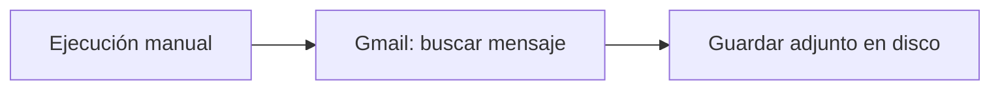
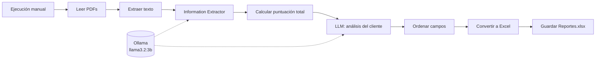
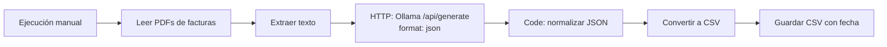

# Flujos de automatización con n8n

Colección de workflows de [n8n](https://n8n.io) hechos durante el módulo de automatización con n8n e IA local (Ingeniería de Sistemas, Universidad de Nariño). Van desde una automatización simple de correo hasta flujos que usan un modelo de lenguaje local con **Ollama** para extraer datos de documentos PDF.

| # | Flujo | Qué hace | Tecnologías |
|---|-------|----------|-------------|
| 1 | [Descarga de adjuntos de Gmail](workflows/01-descarga-adjuntos-gmail.json) | Busca un correo y guarda su adjunto en disco con un nombre ordenado por fecha | Gmail API, sistema de archivos |
| 2 | [Auditoría de marketing: PDF → Excel](workflows/02-auditoria-marketing-pdf-a-excel.json) | Lee encuestas en PDF, extrae puntajes con IA, calcula un total y genera un análisis por cliente en Excel | Ollama (llama3.2:3b), LangChain, XLSX |
| 3 | [Extracción de facturas: PDF → CSV](workflows/03-extraccion-facturas-pdf-a-csv.json) | Lee facturas en PDF y extrae proveedor, NIT, fecha y total a un CSV | Ollama API (JSON mode), JavaScript, CSV |

---

## 1. Descarga de adjuntos de Gmail

Automatiza la descarga de un archivo adjunto recibido por correo.



- Busca en Gmail el último mensaje con asunto `"Práctica 3"` que tenga adjunto.
- Descarga el adjunto y lo guarda en `C:/taller_n8n/` con el formato `AAAA-MM-DD_Sebastian_<nombre-original>` (el nombre está fijo en el nodo; cámbialo según tu caso), para que los archivos queden ordenados por fecha.

**Requiere:** credencial OAuth2 de Gmail configurada en n8n.

---

## 2. Auditoría de marketing: PDF → Excel

Rol: *mercadólogo*. Procesa en lote informes de auditoría / encuestas de satisfacción de clientes y produce un reporte consolidado.



1. Lee todos los PDF de `C:\MiReto\Entrada\`.
2. Con el nodo **Information Extractor** y el modelo local `llama3.2:3b` (temperatura 0.1) extrae: nombre del cliente, correo, empresa y 9 puntajes (P1–P9, escala 1 a 5) sobre planificación, herramientas analíticas, revisión post-campaña, ROI, optimización, etc.
3. Suma los 9 puntajes → **puntuación total sobre 45**.
4. Un **Basic LLM Chain** actúa como consultor de marketing digital y redacta un análisis breve (máx. 4 líneas) de cada cliente.
5. Exporta todo a `C:\MiReto\Reportes.xlsx` con las columnas: Nombre_Cliente, Correo, Empresa, Puntuacion_Total, Analisis.

**Requiere:** Ollama corriendo localmente con el modelo `llama3.2:3b` y la credencial "Ollama account" en n8n.

---

## 3. Extracción de facturas: PDF → CSV (proyecto final)

Perfil: *Analista de Cuentas por Pagar*. Convierte facturas en PDF en datos estructurados listos para contabilidad.



1. Lee las facturas de `C:\MiReto\proyecto_final\facturas\*.pdf`.
2. Envía el texto directamente a la API de Ollama (`http://127.0.0.1:11434/api/generate`) con `format: "json"`, pidiendo solo 4 campos: `proveedor`, `nit`, `fecha` (YYYY-MM-DD) y `total` (número).
3. Un nodo **Code (JavaScript)** limpia la respuesta del modelo: quita bloques ```` ```json ````, parsea el JSON, normaliza las llaves a minúscula y pone `null` en los campos faltantes.
4. Guarda el resultado en `C:\MiReto\proyecto_final\resultados\Datos_Factura_Extraido<fecha>.csv`.

**Requiere:** Ollama corriendo localmente con `llama3.2:3b` (no usa credencial, llama a la API por HTTP).

---

## Cómo usarlos

1. Instala y arranca n8n: `npx n8n` → abre http://localhost:5678
2. Para los flujos 2 y 3, instala [Ollama](https://ollama.com) y descarga el modelo:
   ```bash
   ollama pull llama3.2:3b
   ```
3. En n8n: **Workflows → Import from File** y elige el `.json` de la carpeta [`workflows/`](workflows/).
4. Configura las credenciales que pida cada flujo (Gmail OAuth2, Ollama).
5. Ajusta las rutas de lectura/escritura (`C:\MiReto\...`, `C:/taller_n8n/`) a carpetas de tu equipo y ejecuta.

> Los archivos JSON no contienen contraseñas ni tokens: las credenciales solo aparecen como referencia por nombre y se configuran en cada instancia de n8n.

## Autor

**Sebastián Ordoñez** — [GitHub](https://github.com/sebachox) · [LinkedIn](https://linkedin.com/in/sebachox)
